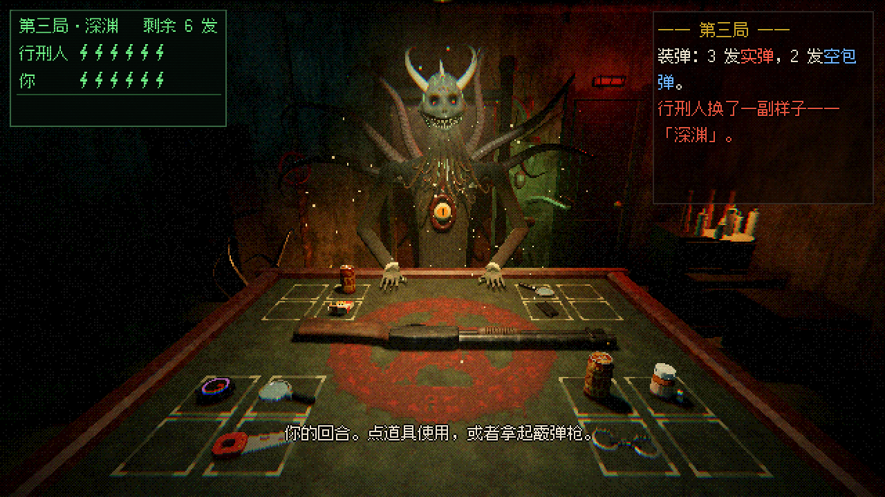
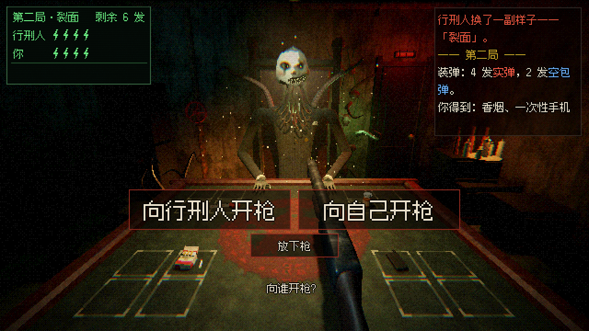
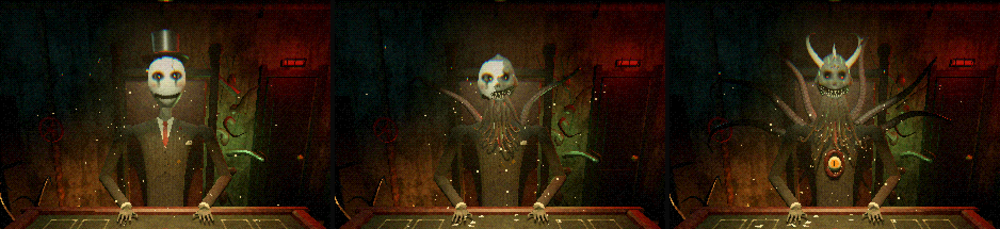

# 枪毙 · 最后一发

用 **Godot 4.3** 做的霰弹枪轮盘赌游戏（单人对战 AI）。你和「行刑人」坐在一张赌桌两侧，轮流拿起一把装着实弹和空包弹的霰弹枪：可以打对方，也可以赌一把打自己。活过三局就能离开。





### 行刑人的三条命



每一局是行刑人的一条命，每条命换一副样子：

| 局 | 形态 | 样子 | 中弹时喷出来的 |
|---|---|---|---|
| 第一局 | **白面** | 白瓷面具（画着黑眼线、泪痕、腮红和一道缝着线的笑）、高礼帽、马甲上挂着怀表链 | 暗红的血，面具上被打出黑洞 |
| 第二局 | **裂面** | 面具碎得只剩半张，露出咧到耳根的尖牙；下巴垂下触手须，背后长出两根大触手，额头三只小眼睁开 | 发黑的血 |
| 第三局 | **深渊** | 头顶骨刺和两根大骨角，脸上爬满发光的绿血管，背后六根触手像光环一样张开；西装胸口裂开一道带牙的肉缝，里面一只发光的眼睛一直盯着你转 | 发光的绿色体液 |

赢下一局，行刑人往前栽倒、瞳孔熄灭；下一局开始前吊灯闪几下灭掉，墙缝里的绿光涌出来，黑暗里面具碎成片掉在桌上、礼帽飞走，新的东西一边抽搐一边长出来，灯再亮起时他已经换了样子，红着眼睛嘶吼。赢下第三局，他的触手枯萎缩回去，彻底倒下。

### 画风

参照 *Buckshot Roulette*：

- **第一人称 3D，克苏鲁风格**：昏暗的夜店地下室，锈管道、门上的红灯、角落的音箱、墙上的邪教海报和血写的符文；后墙裂开一道缝，透着病态的绿光，腐肉和触手从里面爬出来，墙角的排水口里也钻出触手，木箱上点着融化的仪式蜡烛，赌桌中央画着血色法阵。对面高背椅上坐着穿三件套西装（垫肩、口袋巾、胸花）的「行刑人」：深海来的东西，头顶一道骨冠、额头三只小眼、咧到耳根的尖牙笑，下巴垂着会蠕动的触手，手指是黑色的长爪，随着每一局换一个形态（见上面）。他会伸手拿道具；拿枪时先伸手握住，右手握握把、左手托护木（手臂有肘关节，跟着枪的后坐和拉枪栓一起动），把枪托顶在胸口瞄你，或者把枪口拉到自己下巴底下。
- **低分辨率像素渲染**：整个画面按 640×360 渲染，再整数倍放大；3D 画面经过后期着色器，做 Bayer 有序抖动、色阶量化、暗部偏青的分离色调、胶片颗粒、暗角、扫描线和轻微色差。贴图都是 64–256px、最近邻采样。
- **像素中文字体**：界面文字用 [Fusion Pixel 12px](https://github.com/TakWolf/fusion-pixel-font)（SIL OFL 1.1，见 `fonts/OFL.txt`）；左上角是绿色荧光屏样式的计分板。
- **演出**：装弹时子弹先立在桌上展示，再一发发装进枪里；开枪有星形枪口火光、硝烟、后坐、镜头震动，吊灯会被震得摆起来、影子跟着晃；灯光里飘着灰尘，灯下有一道淡淡的光锥。拉枪栓会退出弹壳，看得到颜色。
- **受击**：打中行刑人的那一下画面顿帧、色差猛抖、镜头一缩；他的头往后一甩、整个上身后仰再弹回来，触手剧烈抽搐，手在桌上一抽，头上喷出血滴和血雾，椅背和他面前的桌上溅上血，头上留下伤口（这一局一直留着），再加一声这个形态的嘶叫。你中弹时先顿帧、白屏，镜头被打得往上一仰、歪向一边，血糊在屏幕四周往下淌，耳边嗡嗡耳鸣；黑屏那一下只听得见心跳，再红着眼醒来。只剩最后一点生命时，画面四周随着心跳一下一下泛红。

**美术资源**（`art/`）：概念参考图和贴图原图由 Codex 图像生成画出，再由 Blender 脚本加工成像素贴图；所有模型都是 `art/blender/` 下的 Blender Python 脚本建的（照着概念图），导出成 glb。音效是程序合成的。

**背景音乐**：标题界面放 *Bleak Terminal*（阴冷的科幻恐怖氛围曲），对局中放 *Omen*（受早期 Nine Inch Nails 启发的工业节拍）。枪口对准之后到扣扳机前，音乐会被压成闷声，像隔着水听；枪响或空响的那一刻才放开。你中弹黑屏时音乐也一直闷着，醒来才慢慢回来。两首都是 [Ruskerdax](https://opengameart.org/users/ruskerdax) 在 OpenGameArt 上以 CC0 发布的：[Omen](https://opengameart.org/content/omen)、[Bleak Terminal](https://opengameart.org/content/bleak-terminal)。生成好的模型和贴图都在仓库里，拉下来就能运行，不需要装 Blender。

---

## Steam 上的同类游戏（调研）

| 游戏 | Steam 上线 | 核心玩法 | 对本作的参考 |
|---|---|---|---|
| [**Buckshot Roulette**（恶魔轮盘）](https://store.steampowered.com/app/2835570/Buckshot_Roulette/) | 2024-04-04，作者 Mike Klubnika | 地下夜店里和「庄家」用 12 号霰弹枪玩俄罗斯轮盘。实弹/空包弹数量公开、顺序随机；道具（放大镜、香烟、啤酒、手锯、手铐等）可以看弹、回血、退弹、加伤害、让对手跳过回合 | **核心规则的主要参考**：回合制、打自己空包弹可以连续行动、道具体系、三局递进 |
| **Liar's Bar**（骗子酒馆） | 2024 抢先体验 | 2–4 人联机吹牛：出牌（Liar's Deck）或叫骰（Liar's Dice）。撒谎被抓或者质疑错了，就要拿左轮对自己扣一次扳机（6 个弹巢 1 发子弹） | 「赌桌 + 惩罚开枪」的氛围；以后可以加一个吹牛模式 |
| [**Headshot Roulette**](https://store.steampowered.com/app/3445070/) | 2025-06-28 | 最多 4 人联网的霰弹枪轮盘，带语音 | 多人联机方向 |
| [**Russian Roulette: Online**](https://store.steampowered.com/app/2747720/Russian_Roulette_Online/) | 2024-09-27 | 最多 15 人一桌的俄罗斯轮盘大厅 | 大厅、多人淘汰 |
| [**The Russian Roulette Game : PR**](https://store.steampowered.com/app/2874860/The_Russian_Roulette_Game__PR/) | 2024-04-01（抢先体验） | 4 人大厅 + 少量道具 | — |
| [**99 Lives - Russian Roulette**](https://store.steampowered.com/app/4297590/99_Lives__Russian_Roulette/) | 2026-01-26 | 单人，6 个弹巢、3 个对手 | 多对手的单机模式 |

> 说明：开发环境无法直接访问 Steam 商店，上表来自网页搜索结果（IGN/PCGamesN/GamingOnLinux/Wikipedia 等报道和 Steam 链接）。价格和评价请以商店页面为准。

**结论**：最接近「枪毙游戏」的是 *Buckshot Roulette*：一对一、回合制、靠计数和道具博弈，单人就能玩，用 Godot 2D 实现起来也最合适。本作采用这一套核心玩法，题材、美术、数值和部分道具效果是自己做的。

---

## 规则

- 每次装弹会公布 **实弹** 和 **空包弹** 的数量（2–8 发），然后随机排列装进枪里。
- 轮到你时，可以先使用任意数量的道具，再选择：
  - **向自己开枪**：空包弹 → 你继续行动；实弹 → 你受伤，回合结束。
  - **向行刑人开枪**：不管结果如何，回合都交给对方。
- 子弹打完会重新装弹并发放道具，每次装弹后由你先手。
- 你每回合有 **30 秒**（用道具的演出时间不算）。最后 10 秒计分板变红、开始滴答；时间到，枪会随机对着你或行刑人走火。
- 一共三局，生命和道具逐局增加：

  | 局 | 生命 | 每次装弹发放道具 |
  |---|---|---|
  | 第一局 | 2 | 0（只有运气） |
  | 第二局 | 4 | 2 |
  | 第三局 | 6 | 4 |

- 生命归零就被枪毙。三局都活下来就赢了。每人最多同时持有 8 件道具。

### 道具

| 道具 | 效果 |
|---|---|
| 放大镜 | 查看枪膛里当前这一发 |
| 香烟 | 生命 +1（满血时不能用） |
| 啤酒 | 退出当前这一发，双方都能看到是什么 |
| 手锯 | 下一发实弹伤害 ×2 |
| 手铐 | 对手跳过下一回合（挣脱之前不能再铐） |
| 一次性手机 | 告诉你之后某一发是什么 |
| 极性反转器 | 当前这一发实弹 ↔ 空包弹 |
| 过期药 | 50% 生命 +2，50% 生命 −1 |

### 行刑人 AI

行刑人只能用公开信息做决定：装弹时公布的数量、已经亮出来的子弹、谁用过极性反转器（看不到翻成了什么），以及自己用放大镜或手机看到的子弹。它不会偷看枪膛。大致策略：能回血先回血 → 不知道当前这一发就用放大镜或手机 → 确定是实弹就上手铐、锯枪管、打你 → 确定是空包弹就反转或者打自己 → 什么都不知道就按概率赌：最拿不准时先喝啤酒退一发；空包弹更可能就先反转再打你；实弹概率过半就打你；只有空包弹把握很大时（实弹概率 ≤ 1/3，它自己只剩 1 滴血时 ≤ 15%）才会打自己换一次额外行动，五五开不会赌。

和改进前的 AI 对打 6000 局：新 AI 胜率 61%，并且一次都没有把自己打死（旧 AI 每 3000 局约 380 次）。

---

## 运行

1. 安装 [Godot 4.3](https://godotengine.org/download)（标准版，不需要 .NET）。
2. 用 Godot 打开本目录的 `project.godot`，按 **F5** 运行。窗口默认 1280×720（2 倍放大），全屏会按整数倍放大。

操作：**点击桌上自己这边的道具**来使用；**点击霰弹枪**把枪拿起来，再选「向行刑人开枪」或「向自己开枪」，也可以「放下枪」回去用道具。鼠标停在道具上会显示说明。

## 测试

```bash
# 首次需要先导入一次，生成 class_name 缓存
godot --headless --path . --import

# 规则单元测试 + 400 局 AI 自我对战
godot --headless --path . -s tests/run_tests.gd

# 加载真实场景，加速自动对局（至少 3 局，并且保证有一局打到了发道具的回合），检查流程不会卡死或报错
xvfb-run -a godot --path . --rendering-driver opengl3 -s tests/ui_autoplay.gd
# 也可以用 --headless 跑，但 Godot 4.3 的空渲染器会对程序生成的网格刷
# "mesh_get_surface_count" 错误。这是引擎在无头模式下的问题，用真实渲染器跑时没有这个错误。
```

## 目录结构

```
project.godot            工程配置（640×360 像素渲染，整数倍放大，GL Compatibility）
scenes/main.tscn         主场景（界面和 3D 场景都在代码里搭建）
scripts/
  game_state.gd          纯规则：子弹、生命、道具、回合、手铐，不依赖节点
  dealer_ai.gd           行刑人 AI
  items.gd               道具定义（名称、说明）
  main.gd                游戏流程（async/await）、像素 HUD、菜单、后期特效调度；局与局之间行刑人变身，顿帧等受击演出
  table_scene.gd         3D 场景：房间、吊灯（摆动、光锥、浮尘）、行刑人（三个形态、受击、倒下与变身）、枪、子弹、道具的摆放、动画、火光硝烟和鼠标拾取
  blood_overlay.gd       玩家中弹时糊在镜头上的像素血
  props.gd               材质表和模型入口：加载 art/models 的 glb，按材质名换上 art/textures 的像素贴图
  crt_panel.gd           左上角荧光屏计分板
  sfx.gd                 程序合成音效；背景音乐播放、交叉淡入淡出、开枪前的低通压闷
shaders/
  post.gdshader          后期：抖动、色阶量化、分离色调、颗粒、暗角、扫描线、色差、闪白/黑屏
  light_cone.gdshader    吊灯下的加色光锥（代替体积雾）
  tentacle.gdshader      触手摆动（顶点动画）、受击抽搐和吸盘贴图
  blood_overlay.gdshader 屏幕溅血：血斑和慢慢往下淌的血痕
art/                     美术资源和生产管线（见 art/module.md）
  models/                Blender 导出的 glb：霰弹枪、霰弹、8 种道具、行刑人（三个形态的部件都在一个 glb 里）、赌桌（带法阵）、吊灯、房间（带墙缝触手、蜡烛）
  textures/              像素贴图（64–256px）
  music/                 背景音乐（CC0，OGG）
  blender/               建模脚本（kit.py 共用工具 + build_*.py）和贴图加工脚本 process_textures.py
  source/                Codex 生成的概念图和贴图原图、建模预览图（Godot 不导入）
fonts/                   Fusion Pixel 12px 中文像素字体 + OFL 许可证
tests/
  run_tests.gd           规则测试
  ui_autoplay.gd         场景自动对局测试（可选截图）
```

## 重新生成美术资源

需要 [Blender 4.5 LTS](https://www.blender.org/download/lts/)（便携版即可）。在仓库根目录：

```bash
# 原图 → 像素贴图
blender -b --factory-startup --python art/blender/process_textures.py
# 建模并导出 glb（每个脚本同时把检查图渲染到 art/source/previews/）
blender -b --factory-startup --python art/blender/build_shotgun.py   # 还有 build_shell / build_items / build_dealer / build_room
# 让 Godot 重新导入
godot --headless --path . --import
```

没有 Blender 也可以用 PyPI 上的 `bpy==4.5.*`（Python 3.11）跑这些脚本，具体命令和注意事项见 `art/module.md`。坐标、节点名、材质名的约定也在那里。

## 以后可以做

- 吹牛模式（参考 Liar's Bar）：出牌 + 左轮惩罚
- 本地双人 / 联机多人（参考 Headshot Roulette）
- 难度选择、无尽模式和排行榜
- 导出 Windows / Web 版本
- 开局的公文包发道具动画
